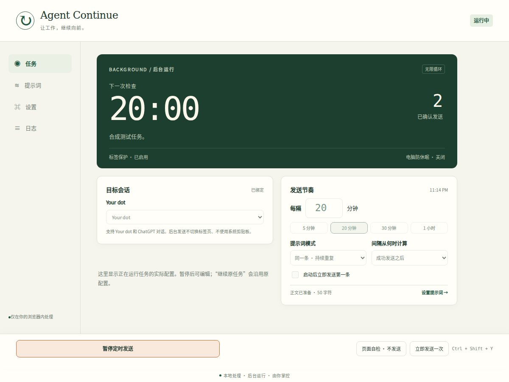
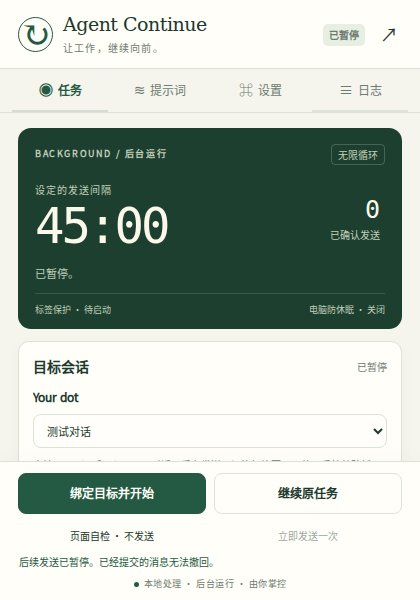

# Agent Continue

**在后台，持续向你的 dot / ChatGPT 会话发送自定义提示词。你照常使用电脑，随时可以暂停。**

Chrome / Microsoft Edge 通用的 Manifest V3 扩展。默认 **每 20 分钟发送同一条提示词，不设次数终点**。提示词可以手动输入，也可以从本机 TXT、Markdown、DOCX、PDF 等文档导入。扩展不会为发送消息激活目标标签页，也不使用系统剪贴板。

**版本 0.2.0 · MIT 开源 · 本地处理 · 无开发者服务器**

[下载 Release](https://github.com/1235357/agent-continue/releases) · [验证记录](VALIDATION.md) · [隐私说明](PRIVACY.md) · [19 个现有方案调研](ALTERNATIVES.md) · [功能路线图](docs/ROADMAP.md)



*界面示意使用合成测试数据，不包含任何用户提示词或真实会话内容。*

<details>
<summary>查看工具栏弹窗</summary>



</details>

## 安装：Chrome 和 Edge

**普通使用下载 Release 安装包，无需 Node.js 或构建。**

1. 下载 `agent-continue-0.2.0.zip`，解压到一个以后不会删除的文件夹。
2. 在浏览器地址栏输入对应地址：

   | 浏览器 | 扩展管理页 |
   | --- | --- |
   | Chrome | `chrome://extensions` |
   | Microsoft Edge | `edge://extensions` |

3. 打开 **开发者模式 / Developer mode**。
4. 点击 **加载已解压的扩展程序 / Load unpacked**。
5. 选择 ZIP 中的 **`AgentContinue` 文件夹**，这个目录应直接包含 `manifest.json`。不要选择 ZIP 本身或它上一级目录。
6. 将扩展固定到工具栏，方便开始、暂停和查看状态。

这是开发者模式安装，不是商店安装。ZIP 不能直接当作 CRX 拖拽安装。浏览器最低版本声明为 Chromium 120；实际验证环境与尚未测试的 Windows / Edge 范围见 [VALIDATION.md](VALIDATION.md)。单位管理的浏览器若禁止本地加载，应遵循其管理设置。[Edge 官方安装说明](https://learn.microsoft.com/en-us/microsoft-edge/extensions/getting-started/extension-sideloading)

GitHub 的 **Code → Download ZIP** 和自动生成的 **Source code** 是源码；PDF 依赖资源需先执行下文开发步骤。Release 的 `agent-continue-0.2.0.zip` 已包含离线资源，可直接加载。

## 第一次使用：给 dot 每 20 分钟发送

1. 打开已登录的 **Your dot** 页面，例如 `https://chatgpt.com/dots/home`，等待会话历史和输入框加载完成。也支持已有的普通 ChatGPT `/c/…` 会话及自定义 GPT 会话。
2. 点击扩展 → **提示词**。选择 **从文件导入**，或者点击 **显示 / 编辑正文** 手动输入。导入后正文默认隐藏，但**实际发送的就是导入的内容**。
3. 回到 **任务**，选择目标标签，保持间隔为 `20`、模式为 **同一条 · 持续重复**。默认已确认发送次数上限为 `0`，停止标记为空。
4. 点击 **页面自检 · 不发送**。它只检查页面结构和状态，不填写输入框，也不发送消息。
5. 点击 **绑定目标并开始**。默认等待完整的 20 分钟再进行首次发送；可以勾选“启动后立即发送第一条”。
6. 切换到其他标签页或应用继续工作。扩展在绑定页面后台操作。
7. 需要停下时点击 **暂停定时发送**，或使用 **Ctrl + Shift + Y**。快捷键可在浏览器扩展快捷键设置中修改。

**“立即发送一次”是真实发送按钮，不是模拟测试。** 它使用当前运行任务的提示词，向绑定会话提交一次消息。

暂停后，**继续原任务**沿用原提示词、目标、间隔及计数；间隔重新计算。若修改了提示词或设置，请点击 **绑定目标并开始** 建立新任务，计数会重置。界面将编辑草稿与实际运行配置分开，避免误以为修改已经影响原任务。

### 通用包与个人预配置包

GitHub 源码和公开 Release **不包含任何个人提示词**。首次安装通用包时，请自行输入或导入。

个人预配置包可以在本机附带原始提示词文件：首次载入时导入扩展配置，正文保持隐藏，**不会自动启动或发送**。个人包不发布到本仓库或公开 Release。它包含明文原文件，不应当作可公开转发的通用安装包。清空本机数据后，不会静默重新导入该预置文件；仍可自行通过文件选择器导入。

## 已实现的功能

| 能力 | 0.2.0 行为 |
| --- | --- |
| 后台操作 | 只对绑定目标注入 DOM 操作；不激活标签、不调用系统键鼠、不访问剪贴板 |
| 无限定时 | 默认 20 分钟；可设 1–10080 分钟；默认无次数、总时长或完成标记终点 |
| 三种提示词模式 | 单条持续重复、队列循环、队列执行一遍；队列最多 50 项，总计最多 60 万字符 |
| 两种计时方式 | 成功发送后开始间隔，或检测到新回复结束后开始间隔 |
| 任务控制 | 开始、暂停、继续、立即发送一次、只读自检、快捷键；暂停按钮固定显示 |
| 空闲与草稿 | 默认等待已识别的忙碌状态；保留输入框已有文字及已识别的附件；可关闭“忙碌时等待” |
| 文件与隐私界面 | 文档在本地解析；正文默认不进入界面 DOM；用户显式显示 / 编辑时才呈现 |
| 队列与模板 | 批量导入文件；队列排序、编辑、删除；最多 30 个本地模板 |
| 自定义停止条件 | 可选次数上限、单遍队列、停止标记；默认均不限制持续重复 |
| 静默时段 | 使用电脑本地时间，支持跨午夜；时段结束后继续检查，不集中补发 |
| 保持活动 | 自动尝试禁止目标标签丢弃；可选防止电脑因空闲休眠；暂停释放保护 |
| 持久任务 | 浏览器重启后恢复启用状态；重新识别原地址，不信任旧 tab ID；目标缺席时等待 |
| 目标防误投 | 精确绑定会话 URL；dot 另核对页面消息标记中的会话身份；多个候选时不随意选择 |
| 记录与备份 | 本地状态日志、导出日志；配置默认导出不含正文，显式选择才包含提示词与队列 |
| 界面 | 中文弹窗与完整控制台，浅色 / 深色 / 随系统主题，实时状态与倒计时 |

当前只运行 **一个目标任务**，支持 ChatGPT 与 Your dot。尚未实现多个并行目标、其他聊天站点、cron / 指定时区计划、模板变量替换、上下文自动迁移、图像批处理、聊天结果导出等功能。我们对照了 19 个相关方案，但**不将“市场全部功能已覆盖”作为本版本声明**。逐项证据和后续验收标准见 [ALTERNATIVES.md](ALTERNATIVES.md) 与 [ROADMAP.md](docs/ROADMAP.md)。

## 文件导入：格式与边界

| 类型 | 支持情况 |
| --- | --- |
| 纯文本 / Markdown | `.txt`、`.md`、`.markdown`：保留正文，不自动补写提示词 |
| 结构化文本 | `.csv`、`.tsv`、`.json`、`.jsonl`、`.yaml`、`.yml`、`.xml`、`.log`、`.ini`、`.cfg`、`.conf`、`.rst`、`.tex`：按原文导入，不执行或解释其中内容 |
| HTML | `.html`、`.htm`：从惰性文档片段提取文字，不渲染脚本或加载远程资源 |
| Word | `.docx`：本地提取正文段落、换行和制表符；不支持旧 `.doc`、宏文件或加密文档 |
| PDF | 本地 PDF.js Worker 提取文字；支持可提取文字的 PDF，不包含 OCR，不支持密码保护文件 |

单文件最大 **5 MiB**，单条提示词最大 **100,000 字符**。DOCX 解压后的正文 XML另有 **4 MiB** 限制；PDF 最多 **100 页**，解析设置超时，避免损坏或异常文件占用过多资源。文件格式说明见 [FILE_FORMATS.md](docs/FILE_FORMATS.md)。

文本编码可自动识别 UTF-8 / UTF-16 BOM，并在 UTF-8 无效时尝试 GB18030；也可以手动指定 UTF-8、GB18030、UTF-16 LE / BE。自动编码判断不是所有文件都准确；出现乱码时请自行显示检查，或另存为 UTF-8 后导入。

纯文本的空格、换行在配置中保留，BOM 会移除。DOCX、PDF、HTML 是**提取文字**，复杂排版、表格阅读顺序和格式不能保证原样保留。发送时目标网页的富文本编辑器也可能规范化段落或换行；本项目不承诺文档字节与网页渲染结果完全一致。

## “无限运行”的具体含义

默认单条重复任务没有隐藏的次数或总时长终点。遇到忙碌、草稿、已识别附件、页面加载、离开目标地址或目标关闭时，任务保留启用状态并等待恢复。只有手动暂停，或你显式配置的次数上限、停止标记、单遍队列完成条件，才按相应设置结束发送。

**次数上限只统计已确认发送。** 未知回执不会增加计数，因此该选项不是底层实际提交次数的硬上限。

如果已经点击发送，但页面没有提供足够证据确认新消息，本周期标记为 **结果未知**，**不立即重试**，等待完整正常间隔后再继续。上一条消息可能已经被服务接收，因此这不构成严格的 exactly-once 交付。看到未知结果时，可先暂停并核对会话记录。暂停只能阻止后续提交，无法撤回已经点击的发送。

浏览器重新启动后，任务设置可以恢复；旧 tab ID 会被丢弃，只有找到唯一匹配的原页面并通过身份检查才会继续。扩展不会为恢复目标而自动打开或激活聊天标签。任务仍然启用，不等于网页已可发送。

**电脑与浏览器必须运行，目标网页必须可执行并保持登录。** 电脑睡眠、关机、浏览器关闭期间无法发送。调度使用 `chrome.alarms`，每分钟检查一次；间隔不是秒级实时保证，繁忙、节能与睡眠恢复可能延迟。错过的周期不会排成一串集中补发。[Chrome Alarms 官方说明](https://developer.chrome.com/docs/extensions/reference/api/alarms)

本扩展提交新的聊天消息；它不会扩大账号额度、模型上下文或服务端任务上限，也不保证 Agent 会永远执行或自动完成目标。

## 标签保护与电脑防休眠

“禁止自动丢弃”“禁止页面冻结”“防止电脑空闲休眠”是不同机制。

- **标签防丢弃**默认开启：任务运行时尝试设置目标标签 `autoDiscardable: false`，暂停后恢复原值。[Tabs API](https://developer.chrome.com/docs/extensions/reference/api/tabs)
- **电脑防休眠**可选开启：申请 `power` 权限，通过 `requestKeepAwake('system')` 防止因空闲睡眠，允许屏幕关闭；不阻止合盖或手动休眠。[Power API](https://developer.chrome.com/docs/extensions/reference/api/power)
- 浏览器仍可能冻结后台页面。请将 `chatgpt.com` 加入浏览器的 **始终保持这些网站活动** 列表：Chrome 的“设置 → 性能”；Edge 的“设置 → 系统和性能”。具体名称可能随版本与语言变化。[Chrome 设置](https://support.google.com/chrome/answer/12929150) · [Edge 设置](https://support.microsoft.com/en-us/edge/learn-about-performance-features-in-microsoft-edge)

普通扩展没有跨 Chrome / Edge 通用的接口，能直接写入所有“永不睡眠”网站例外。显示“标签保护已启用”只代表防丢弃设置成功，不代表所有冻结或睡眠策略关闭。扩展不会用抢占前台来唤醒页面。

## 数据与权限

| 权限 / 数据 | 用途 |
| --- | --- |
| `https://chatgpt.com/*` | 识别被授权站点的目标标签、注入页面操作，并在重启后重新绑定；不请求 `<all_urls>` |
| `activeTab` | 用户从工具栏打开扩展时访问所选标签 |
| `scripting` | 在指定目标执行只读检查、填写和发送逻辑 |
| `storage` | 当前运行状态、原任务恢复信息、配置、模板和日志保存在本机 |
| `alarms` | 唤醒扩展调度器进行到期检查 |
| 可选 `power` | 用户开启电脑防休眠时申请 |

没有 API key、开发者服务器、分析遥测、Chrome Sync、Cookie 读取或系统剪贴板操作。运行所需的 PDF 模块、字体和字符映射随安装包一起提供，不从 CDN 加载。**发送时，提示词会交给你绑定的聊天服务**，其后续处理受该服务规则约束。

本机 `chrome.storage.local` **不是加密保险箱**。拥有浏览器配置文件访问权限的人、能够检查扩展内存的调试工具等仍可能看到内容。隐藏界面正文可避免普通截图或界面检查意外展示，但不等于加密。完整数据流、导出与清理说明见 [PRIVACY.md](PRIVACY.md)。

## 开发、验证与打包

需要 **Node.js 22.13.0+、npm、Python 3**。源码采用原生 JavaScript；PDF.js 是离线文档解析依赖，Playwright 用于测试。

```bash
git clone https://github.com/1235357/agent-continue.git
cd agent-continue
npm ci --ignore-scripts
npm run vendor
npx playwright install --with-deps chromium
npm test
python3 scripts/package.py
```

`npm run vendor` 从锁定版本的 `pdfjs-dist` 生成本地 PDF 资源及来源清单。GitHub 源码不直接提交这套体积较大的生成资源；Release 包已包含它们。安装依赖与下载测试浏览器需要网络，扩展运行时解析文档不需要开发者网络服务。

可选 `python3 scripts/package.py --source` 生成含开发文件的源码包。产物位于 `dist/`，安装 ZIP 根目录为 `AgentContinue/`。打包使用明确的文件范围，不包含用户上传文件、私用预置文件、测试浏览器、`node_modules` 或登录状态。

当前验证包括 **104 个场景**：后台状态、普通 / dot 页面适配、本地文件解析、界面隐私与真实 MV3 集成。真实 MV3 测试使用独立 Chromium 配置文件和合成网页，确认扩展消息权限、后台发送、焦点保护、暂停、PDF Worker CSP 与浏览器重启恢复。**这不等同于真实 Windows / Edge 或私人会话发送实测。** 准确范围、环境和复现命令见 [VALIDATION.md](VALIDATION.md) 与 [tests/README.md](tests/README.md)。

仓库配置了 push / PR / 每周 CI、Dependabot，以及版本标签触发的测试、打包和 Release ZIP / SHA-256 发布流程。自动检查能发现已覆盖的回归，不能自动保证网站改版后仍然兼容，也不代表有人在无人值守地持续修复。实际远程运行结果以 [GitHub Actions](https://github.com/1235357/agent-continue/actions) 为准。维护步骤见 [CONTRIBUTING.md](CONTRIBUTING.md)。

开发者模式安装没有商店自动更新。更新前先暂停任务，保留当前本机配置；用新版本替换原安装目录的扩展文件，在扩展管理页点击重新加载，然后自检并确认任务状态。

## English overview

Agent Continue is an MIT-licensed Manifest V3 extension for Chrome and Microsoft Edge. It sends a custom prompt to one selected ChatGPT or Your dot conversation in the background, every **20 minutes by default**, indefinitely until manually paused or an explicitly configured stop condition is reached.

Features include local text / Markdown / DOCX / PDF import, hidden-by-default prompt contents, repeating and one-shot queues, reply-aware timing, quiet hours, local templates, themes, redacted activity logs, restart recovery, discard protection, and optional system idle-sleep prevention. It does not activate the target tab or access the system clipboard. There is no developer backend, telemetry, or cloud synchronization; local storage is not encrypted.

Download the prepared Release ZIP, extract it, and load its `AgentContinue` directory using **Developer mode → Load unpacked**. A source checkout requires `npm ci --ignore-scripts` followed by `npm run vendor` before loading.

The browser and computer must remain running. Sending confirmation is based on rendered messages, not an exactly-once server protocol. Current scope is one ChatGPT / dot target; other providers, parallel targets, cron schedules, context migration, and output export are not implemented. See the validation, privacy, alternatives, and roadmap documents for precise boundaries.
