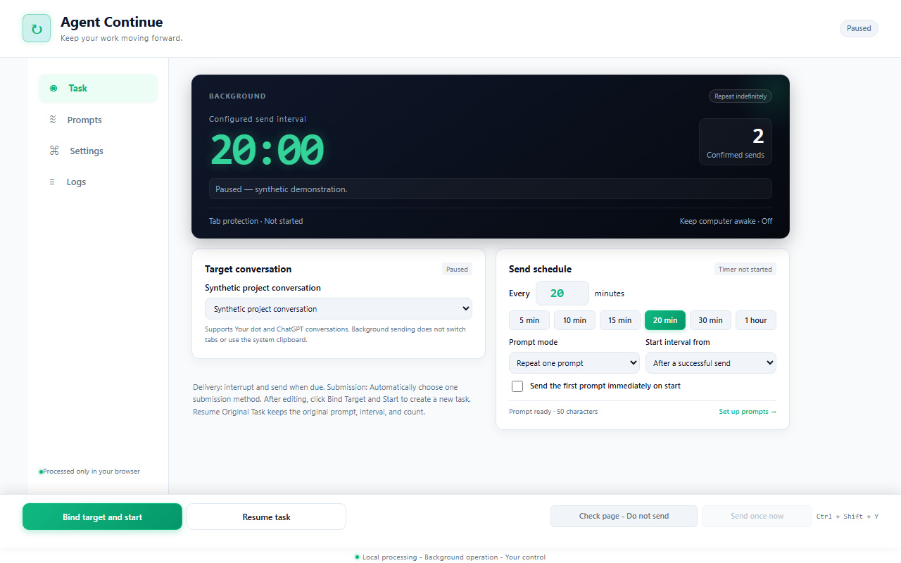

# Agent Continue

English | [简体中文](https://github.com/1235357/agent-continue/blob/main/README.zh-CN.md)

Schedule your own prompts in one existing ChatGPT or Your dot conversation. The Windows-enabled version also offers separately installed, explicitly authorized file, shell and process tools.

**3.0.12 unreleased Windows-enabled source candidate. Manifest V3. Free and MIT-licensed.**

[Chrome Web Store](https://chromewebstore.google.com/detail/jpioilmpbolfokedaefmbfbjeaahfdkl) · [GitHub Releases](https://github.com/1235357/agent-continue/releases) · [Source](https://github.com/1235357/agent-continue) · [Changelog](https://github.com/1235357/agent-continue/blob/main/CHANGELOG.md) · [Privacy](https://github.com/1235357/agent-continue/blob/main/PRIVACY.md)

The separately released v2.2.1 remains scheduler-only, including its acknowledgement fixes, developer support and schema 3 diagnostics; its published assets are preserved. Source version, GitHub release availability, npm publication, Chrome Web Store review and your installed version are separate states. Consult the respective listing and your browser's extension details rather than treating this README as a publication or installation receipt.

The root npm CLI version remains independently 0.3.0. Check the GitHub Release, Chrome Web Store listing, and installed extension details for their respective versions.

## Windows Device Setup

Choose current-account or administrator scope, consent to the stated access, then copy and run the reviewed PowerShell or CMD setup command from the verified, extracted source bundle. Copying does not run it. The guided commands can download, verify and extract official portable Node.js after consent if a compatible version is missing. Current delivery is command-only, not the retired custom Agent Continue launcher/EXE/MSI route; Node.js, the official OpenAI tunnel client and upstream dependencies still run outside the browser. See the repository's [setup commands and scope choices](https://github.com/1235357/agent-continue/blob/main/native/bootstrap/README.md#windows-command-installation). Use a versioned release bundle; source commands do not establish that a public npm package is available.

**Once connected and authorized, a conversation can read/write files, execute shell commands and manage processes across the selected Windows account, not just the installation folder. This is not a sandbox.** Current-account setup uses existing privileges. Administrator setup separately requests Windows elevation (UAC), stages a protected Program Files runtime, and registers its browser host and administrator-owner task. Standalone current-account setup does not register a browser host; browser-managed current-account setup uses HKCU, and administrator enrollment uses protected HKLM registration. Optional browser `nativeMessaging`, Windows approval and OpenAI conversation authorization are separate grants. Installation is not chat authorization. Browser-managed installers finish paused. With fresh installation-and-connection consent, the unchanged initiating Setup page can separately request one connection after matching installation readback. Current-account continuation uses its own one-time proof, not administrator transport or a previous install-only consent. Existing installations are not automatically adopted or unpaused, and uncertain operations are checked under their original IDs rather than replayed. Standalone current-account setup can request one connection with tunnel inputs and connection consent (`CONNECT` in the guided prompt); browser-managed guided setup confirms `REGISTER` without starting the tunnel in that installer step. Installation and connection may require separate UAC approvals. Final installed-artifact acceptance of this candidate flow remains open.

Hosted tools need your configured OpenAI workspace/app, official tunnel and a runtime-key file protected on the device. Enter only the file path in the local terminal, not the key in the extension, clipboard, copied command or chat. Current-account configuration references the original file; administrator binding copies it to the protected local `<bundle-root>.secrets/runtime.key`. The original remains your responsibility. Tool arguments and sensitive results, including file contents, command output and process details, travel through OpenAI, not a developer relay. Access controls do not eliminate plaintext secrets on disk/in memory or make this traffic local-only.

The pinned Desktop Commander dependency has upstream telemetry, enabled by default independently. The wrapper disables it with both `telemetryEnabled: false` and `DESKTOP_COMMANDER_DISABLE_TELEMETRY=1` before provider imports, validates that policy on launch, and acquires dependencies with npm lifecycle scripts disabled. This is not a claim that all device traffic is blocked. Local tool history can retain arguments/results; warning-level tunnel logs, prepared commands when used, and durable device/administrator records are distinct from the content-reduced extension activity export. Some control evidence survives Clear Data. Review [Windows data handling](https://github.com/1235357/agent-continue/blob/main/PRIVACY.md#optional-windows-access-and-approvals) before enabling access.

Device Pause is separate from scheduler Pause; ordinary Disconnect and pause does not stop the separate administrator runtime. Check exact native stop outcomes, not only request acknowledgements. Revoke denies future starts for that installation; revoke OpenAI chat/key access separately. Administrator browser-reopen restoration is off unless opted in and may restore only still-authorized saved-running intent, never override manual Pause/Revoke. These controls cannot undo earlier changes, retract results or necessarily stop detached programs. Clearing extension data/uninstalling the extension does not remove native runtimes, task/host registrations, protected credentials or Windows history. The setup uninstall option currently creates a plan, not completed removal.

The November 8 acceptance checkpoint records a real browser connection to the protected runtime matching the 3.0.4 native payload. Ordinary ChatGPT and Dot each executed an administrator command, a temporary-file write/read and start/stop of their own child process; the results were independently checked on the host. This installation's browser-managed Pause/Revoke and full-browser-reopen recovery are still separate, unverified gates. The later `main` fix for an unassociated legacy Pause record is not present in the immutable 3.0.4 release assets.

Historical checkpoint97 records a different, r11 installation's actual full-app quit/reopen, saved-running recovery and matching Devices Pause/Revoke stop receipts; that installation was left revoked and not running. Do not reuse those receipts as current-installation proof. These bounded tests do not guarantee future recovery or establish current-account hosted operation, automatic adoption or Store approval. Matching release artifacts and review-submission receipts are tracked separately in [Runtime Acceptance](https://github.com/1235357/agent-continue/blob/main/docs/RUNTIME-ACCEPTANCE.md). Read current status before acting; this documentation does not reconnect anything. [Development handoff](https://github.com/1235357/agent-continue/blob/main/docs/DEVELOPMENT-HANDOFF.md) preserves dated results and their limits.

## Developer and Support

The candidate's Activity panel includes per-delivery diagnostics: current phase/reason, model/DOM write counts, readiness and authorization retries, actual extension dispatch attempts, manual handoff, receipt observation, and elapsed/synchronous-write timings. It retains the latest 20 deliveries and 64 stage changes each, with truncation and persistence-health metadata. Export schema 5 includes these snapshots, not prompts, chat text, paths, keys or raw exceptions. A manual Send of the prepared prompt stops further injection while its matching receipt is checked; manual and extension deliveries have separate counters. This source-candidate behavior is not proof that an older installed release has been updated.

- **Developer:** Zhentong Ye
- **Email:** [zhentongye2028@u.northwestern.edu](mailto:zhentongye2028@u.northwestern.edu)
- **Project:** [1235357/agent-continue](https://github.com/1235357/agent-continue)
- **Bug reports:** [Open a GitHub issue](https://github.com/1235357/agent-continue/issues/new/choose) or [check existing issues](https://github.com/1235357/agent-continue/issues)
- **Author's LinkedIn:** [Zhentong Ye](https://www.linkedin.com/in/tony-zhentong-ye/)

Open **Developer & support** from the support link in Settings or Activity to view these contacts and the installed extension version. The page defaults to English and offers Simplified Chinese. For a bug report, manually provide the extension version, browser version, operating system, and steps to reproduce with synthetic prompts. Describe the expected and actual behavior, and select ordinary ChatGPT, Your dot, or **Not applicable / extension interface** for an interface, settings, or import problem. The separate **Suggestion** form does not require a conversation target or logs.

If diagnostics would help, manually export them from Activity or the support page and review the JSON file before sharing it. Both use schema 5, include the installed extension version, and omit stored free-text messages and unknown fields. You may attach a sanitized copy in the GitHub issue's optional diagnostics field. **GitHub issues and their attachments are public.** Remove identifying data, private prompts, conversation URLs, credentials, cookies, and documents from all report text and attachments. Do not attach configuration backups, runtime keys, raw tool history, prepared commands or native state directories. Logs can reveal task timing and status; an export is not guaranteed to be anonymous. Exporting logs does not upload them or contact support automatically.

Logs are timestamped locally, but diagnostic exports use relative millisecond timings by default, without exact timestamps or the export time. Only the support page offers **Include exact timestamps**, off by default; the Activity export has no exact-timestamp option. Relative timings can also identify activity patterns. A `timing-probe` diagnostic can retain `kind`, `status`, numeric `durationMs`/`firstMs` bounded to 0–Number.MAX_SAFE_INTEGER ms, and actual boolean `hidden`, `ok` and `allowed` values. These locally collected fields reveal page visibility and probe/authorization outcomes when present; omitting message text is not a claim of no data collection. See [diagnostic export details and privacy limits](https://github.com/1235357/agent-continue/blob/main/PRIVACY.md#diagnostic-log-export).

The screenshot shows the v2.1.0 console with synthetic content, not a private conversation or evidence of a v2.2.1, 3.0.1 or 3.0.2 installation.

## Scheduler Installation

Use the [Chrome Web Store listing](https://chromewebstore.google.com/detail/jpioilmpbolfokedaefmbfbjeaahfdkl), or select an available packaged ZIP from [GitHub Releases](https://github.com/1235357/agent-continue/releases).

For a packaged ZIP, extract it to a permanent folder, open `chrome://extensions` or `edge://extensions`, enable Developer mode, and choose **Load unpacked**. Select the `AgentContinue` folder containing `manifest.json`. Do not select the ZIP or its parent folder. Chromium 120 or later is declared in the manifest; this is not a claim that every browser/platform combination has been tested.

GitHub's automatic source archives are not prepared installation packages: PDF resources must be assembled using the repository's development instructions. See [CONTRIBUTING.md](https://github.com/1235357/agent-continue/blob/main/CONTRIBUTING.md) and [VALIDATION.md](https://github.com/1235357/agent-continue/blob/main/VALIDATION.md) for build and validation scope.

## Start a Task

1. Open an existing ChatGPT or Your dot conversation on `chatgpt.com`, sign in there, and wait for its composer to load.
2. Open the extension and enter a prompt or import a local file.
3. Select the target tab and review the interval and delivery settings. Defaults are a 20-minute interval, repeated use of the same prompt, no confirmed-send limit, and interruption of an active response when due.
4. Run the read-only page check, then bind the target and start. The first send waits a full interval unless you enable immediate first sending.
5. Pause from the extension or with `Ctrl+Shift+Y`. **Send once now** submits a real message; it is not a simulation.

The interface defaults to English. Select Simplified Chinese in **Settings → Language / 语言**. The preference is saved locally; switching languages does not translate your prompts, imported text, or custom labels.

Resume retains the original task's prompt, target, interval, and counters. To apply edited settings, bind and start a new task; its counters reset. Importing a document alone does not start a task or send a message.

## Scheduler Capabilities

| Area | Behavior |
| --- | --- |
| Target | One task at a time, bound to a ChatGPT or Your dot conversation |
| Prompts | Repeat one prompt, loop a queue, or run a queue once; local templates |
| Timing | 1–10080 minutes; interval or reply-aware timing; optional local-time quiet hours |
| Controls | Start, pause, resume, send once, read-only checks, optional confirmed-send limit and stop markers |
| Page handling | Exact target identity checks, mandatory replacement of unsent text, pending-attachment removal, continuous pre-submission recovery |
| Background operation | Does not activate the target tab or use the system clipboard |
| Local interface | English and Simplified Chinese; system, light, and dark themes; prompt text hidden until explicitly shown |
| Records | Up to 200 locally timestamped activity entries; diagnostic JSON exports default to relative timings and omit stored free-text messages |
| Support | Developer contacts, installed version, and schema 5 diagnostics; exact-timestamp export requires support-page opt-in |
| Recovery | Saved task recovery when the original target is uniquely identified; no automatic opening of a missing target |

### One Submission Mechanism per Attempt

Each attempt requires a current background permit and uses one submission mechanism. Automatic mode first uses an available Send button in the bound target composer; otherwise it uses Ctrl+Enter in Your dot or Enter in ordinary ChatGPT. Explicit button-only and Ctrl+Enter-only modes are also available. There is no subsequent switch to another mechanism within that attempt.

**Scheduled sends replace unsent text and remove pending attachments in the bound conversation before sending the configured prompt.** Every SEND, including **Send once now**, uses the configured prompt instead of existing composer text. Text changes, a replaced composer or a temporarily unavailable Send control do not end the pending round: preparation is retried continuously, with no fixed total readiness deadline. Pending attachments are detached using the website's removal controls, not deleted from account storage or original local files. This policy is mandatory, not a Settings toggle. The legacy boolean `extensionPriority` remains accepted but normalizes to `true`, even when an old saved or imported configuration says `false`. **Resume** keeps the original prompt, target, interval and counts, not the retired draft-protection policy. Start/Resume add no modal, permission or runtime access grant. Manual Pause, current authorization and exact-target guards remain. A submission already attempted but not confirmed is never blindly replayed. See [Mandatory Composer Priority](https://github.com/1235357/agent-continue/blob/main/docs/COMPOSER-PRIORITY.md).

A current enabled send has no fixed total readiness or receipt-wait cutoff. Delayed rendering and a missing injection return do not authorize another click: the same invocation keeps waiting, with an independent validated result-message channel, until a result, Pause or target invalidation. Finite individual command permits are renewed only for that live invocation; they are not a total waiting-time limit. This does not guarantee progress from a frozen page or an unavailable service.

A matching new user-message marker is required for confirmation. An empty composer or a busy indicator alone is not success. A terminal uncertain result remains **unknown**, the confirmed-send count does not increase, and no immediate retry occurs. A later attempt may occur after the full normal interval. This is not exactly-once delivery: an unconfirmed message may already have reached ChatGPT. Pause and inspect the conversation when the result is uncertain. Pausing cannot retract a submission already dispatched. If page-side cancellation cannot be acknowledged, the interface reports that uncertainty and temporarily fences the old finite command permit instead of claiming it stopped.

Confirmation is a page-level observation, not a service receipt. A known node reused for a new message remains uncertain. Historical content remounted with both a different node and a previously unseen ID cannot be reliably distinguished from a new acknowledgement by these DOM checks alone.

### Runtime Limits

The computer and browser must be running, and the target page must remain executable and signed in. Alarm-based scheduling, background ports, and tab discard protection do not guarantee exact timing or prevent all freezing. Missed intervals are not replayed in a burst. Optional idle-sleep prevention uses the `power` permission; it does not override manual sleep or lid-close behavior.

Page changes can break compatibility. This extension sends messages; it does not extend account quotas or model context, and it does not guarantee that an agent continues working or completes a goal. Test and browser-validation records have the specific scope stated in [VALIDATION.md](https://github.com/1235357/agent-continue/blob/main/VALIDATION.md), not permanent live-site acceptance.

## Local File Import

Text and Markdown files, structured text, HTML, DOCX, and text-based PDF are processed locally. HTML is reduced to text without executing its scripts; DOCX and PDF import extract text rather than preserve layout. PDF parsing uses bundled PDF.js resources, not an online converter or runtime CDN. Scanned PDFs need OCR elsewhere; legacy `.doc`, encrypted documents, and password-protected PDFs are not supported.

There is no application-set prompt character limit, aggregate queue-text limit, or plain-text file byte limit. The queue supports 50 items. Browser storage, available memory, browser messaging and the target service still impose practical limits; oversized payloads are never silently truncated. Document-parser safeguards remain: DOCX/PDF input up to 5 MiB, DOCX body XML up to 4 MiB, and PDF import up to 100 pages with a 20-second parsing timeout. Encoding detection and reading order can be imperfect. Review extracted text before using sensitive or layout-dependent documents. See [File Formats](https://github.com/1235357/agent-continue/blob/main/docs/FILE_FORMATS.md).

## Privacy and Permissions

Prompt scheduling/file import require no separate extension account or API key and use no developer-operated collection backend, analytics telemetry or cloud synchronization. ChatGPT sign-in is still required on the target website. Submitted prompts are handled under that service's policies. Optional hosted Windows tools instead require the local runtime key and separate grants described above, and send tool arguments/results through OpenAI. The telemetry configuration and Windows records are described in [PRIVACY.md](https://github.com/1235357/agent-continue/blob/main/PRIVACY.md#windows-telemetry-logs-and-durable-records), not covered by a scheduler-only no-key claim.

| Permission | Purpose |
| --- | --- |
| `https://chatgpt.com/*` | Identify the target, inspect its state, fill its composer, submit prompts, and recover the original target |
| `activeTab` | Access the selected tab through a user action |
| `scripting` | Run target-page checks and sending logic |
| `storage` | Store configuration, prompts, queues, templates, language, theme, logs, and recovery state locally |
| `alarms` | Wake the scheduler for due checks |
| Optional `power` | Prevent system idle sleep when explicitly enabled |
| Optional `nativeMessaging` | Reach the separately installed Windows bridge for bounded status/lifecycle controls and prepared-process reference checks; not installation, elevation or a chat grant |

Historical stable v2.2.1 does not request `nativeMessaging` or include Windows control. The Windows-enabled manifest retains that optional permission without all-site, Cookie, clipboard or debugger permissions. This browser permission boundary is not a sandbox for separately authorized Windows tools. Setup can copy its command through the clipboard API after a user gesture; scheduler sending does not use the clipboard.

Local storage is not encrypted. Hiding prompt text reduces accidental on-screen exposure but is not a security boundary. Configuration exports omit prompt and queue bodies unless explicitly included. Clear Data retains the language preference and durable device/control evidence, removes the administrator browser-restore preference, and does not issue Windows Pause/Revoke. It does not remove native state, original files, exported files or data already sent to ChatGPT. See [PRIVACY.md](https://github.com/1235357/agent-continue/blob/main/PRIVACY.md) for storage, deletion and disclosure details.

## Project

Contributions: [1235357/agent-continue](https://github.com/1235357/agent-continue). Licensed under [MIT](LICENSE).
