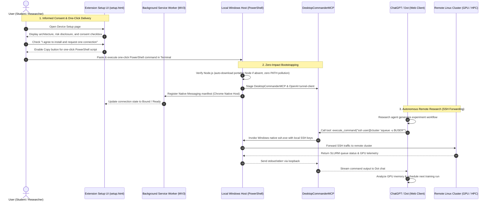
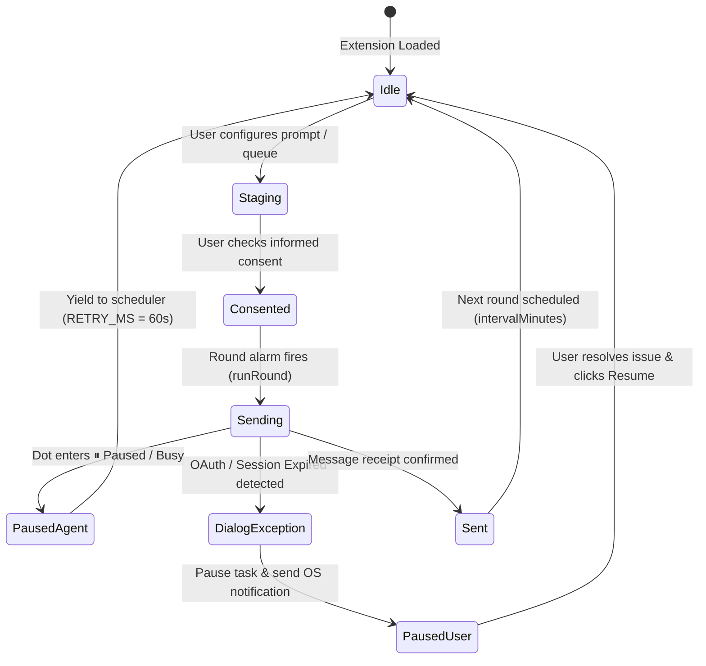

# Windows Direct Tunnel, SSH Forwarding, and Sovereign Agent Architecture

**Author:** Zhentong Ye  
**Affiliation:** Northwestern University, Master of Science in Computer Science (MSCS)  
**Academic Coursework Grounding:**  
- **CS 381:** Software Design Principles and Practices (Design Patterns, Separation of Concerns, Resilient Fault Tolerance)  
- **CS 310:** Scalable Software Architectures (IPC Boundaries, Thread Isolation, Anti-Thrashing, Non-Blocking Event Loops)  
- **CS 496:** Special Topics in Computer Science: Agent AI (Autonomous Orchestration, Model Context Protocol, Sandboxing)  
**Project:** Agent Continue — Manifest V3 Chrome Extension & Windows Native MCP Integration  
**Date:** November 2026  

---

## 1. Executive Summary & Core Philosophy

### 1.1 The "Authenticated Personal Avatar" Paradigm
Modern foundation models and interactive agent environments (such as OpenAI ChatGPT and the specialized autonomous research agent **Dot**) possess advanced reasoning and problem-solving capabilities. However, when operating inside a standard web browser sandbox, they are fundamentally constrained: they cannot inspect local files, run terminal diagnostics, schedule system processes, or interface with remote high-performance computing (HPC) clusters.

**Agent Continue** solves this gap by transforming ChatGPT and Dot into a trusted **Personal Avatar**—a virtual agent operating strictly on the user's behalf with identical authority to the logged-in user. Rather than inventing fragile proprietary protocols or relying on third-party SaaS middleboxes, Agent Continue bridges web agents to local operating systems via:
1. **The Official OpenAI `tunnel-client`**: Directly binding OpenAI's cloud agent tools to the local loopback host.
2. **DesktopCommanderMCP Integration**: Exposing robust native operating system commands, filesystem operations, and process lifecycle management through the standardized **Model Context Protocol (MCP)**.
3. **Native Windows OpenSSH Forwarding**: Utilizing the local host's existing Windows OpenSSH client (`ssh.exe`) and cryptographic key store to provide Dot and ChatGPT with direct, end-to-end access to remote Linux research clusters (e.g., Northwestern Quest HPC, SLURM queues, GPU servers).

### 1.2 The Zero-Intermediary / Direct-Connection Rule
A foundational architectural invariant of Agent Continue is **Absolute Zero Third-Party Relay**:
- **No Middleman Server**: Tool parameters, system outputs, and files never traverse third-party servers, developer-operated proxies, or intermediate analytics backends.
- **End-to-End Cryptographic Security**: Traffic flows exclusively between the official OpenAI agent infrastructure and the user's local Windows machine via authenticated, encrypted loopback tunnels.
- **Privacy by Design**: Web agents only touch local resources that the user explicitly authorizes through informed consent gates.

```
┌────────────────────────────────────────────────────────────────────────┐
│                          ZERO-INTERMEDIARY TOPOLOGY                    │
│                                                                        │
│   ┌────────────────────┐            Official Encrypted Tunnel          │
│   │  ChatGPT / Dot Web │ ◄─────────────────────────────────────────►   │
│   │   (chatgpt.com)    │                                           │   │
│   └─────────▲──────────┘                                           │   │
│             │ DOM Injection & Monitoring                           │   │
│   ┌─────────▼──────────┐                                           │   │
│   │   Agent Continue   │                                           │   │
│   │   Chrome Ext (MV3) │                                           │   │
│   └─────────▲──────────┘                                           │   │
│             │ Native Messaging / Browser Wake                      │   │
│             │                                                      │   │
│   ┌─────────▼──────────────────────────────────────────────────┐   │   │
│   │ Windows Host (Local PC)                                    │   │   │
│   │   ├── OpenAI tunnel-client (Portable Node.js Runtime)       │ ◄─┘   │
│   │   ├── DesktopCommanderMCP Server                           │       │
│   │   └── Windows OpenSSH Client (ssh.exe + Local Keys)        │       │
│   └──────────────────────────────┬─────────────────────────────┘       │
│                                  │ Direct SSH Tunnel                   │
│                                  │ (No Cloud Proxy)                    │
│   ┌──────────────────────────────▼─────────────────────────────┐       │
│   │ Remote Linux Research Server (GPU / SLURM / HPC Cluster)   │       │
│   └────────────────────────────────────────────────────────────┘       │
└────────────────────────────────────────────────────────────────────────┘
```

---

## 2. End-to-End System Architecture & Data Flow

### 2.1 Four-Tier Topological Decomposition

| Layer | Responsibility | Components | Security Invariants |
|---|---|---|---|
| **Tier 1: Web Interface** | User interaction, agent output rendering, prompt submission | `chatgpt.com`, Dot conversation interface, Markdown renderer | Sandboxed inside Chrome web renderer. No direct OS access. |
| **Tier 2: Chrome Extension (MV3)** | Prompt scheduling, cyclic queue automation, exception classification, native messaging bridge | `background.js` (Service Worker), `content.js`, `dialog-classifier.js`, `adapter.js` | MV3 permissions (`activeTab`, `scripting`, `alarms`, optional `nativeMessaging`). No raw credentials in memory. |
| **Tier 3: Windows Local Host Anchor** | Local command execution, filesystem access, process management, loopback tunnel | `native/bootstrap/install.ps1`, `DesktopCommanderMCP`, `openai/tunnel-client`, portable Node.js | Single-user installation in `%LOCALAPPDATA%\AgentContinue`. No PATH pollution. |
| **Tier 4: Remote Linux Infrastructure** | Scientific research computation, SLURM batch jobs, GPU training, dataset storage | University HPC clusters, remote Linux workstations | Native OpenSSH mutual public-key authentication. Private keys never leave Windows host. |

### 2.2 Sequence Diagram: Setup, Handshake, and SSH Execution



---

## 3. Comparative Analysis: DesktopCommanderMCP vs Agent Continue

Agent Continue builds directly upon the architectural insights established by [wonderwhy-er/DesktopCommanderMCP](https://github.com/wonderwhy-er/DesktopCommanderMCP) and [openai/tunnel-client](https://github.com/openai/tunnel-client), while addressing key gaps required for consumer-grade browser extension deployment:

| Feature / Dimension | DesktopCommanderMCP Standalone | OpenAI tunnel-client | Agent Continue (Integrated Suite) |
|---|---|---|---|
| **Delivery Model** | CLI scripts (PowerShell, CMD, Node.js) | Standalone Node.js CLI package | Chrome Extension (MV3) + One-Click Terminal Command |
| **User Onboarding** | Manual terminal cloning and configuration | Developer-focused API keys and tokens | Visual Setup Wizard with explicit Informed Consent checkbox |
| **Runtime Dependencies** | Requires pre-installed Node.js / Python | Requires global `npm install` | Automatic portable Node.js provisioning (no global PATH changes) |
| **Browser Integration** | None (decoupled MCP server) | None (decoupled tunnel client) | Real-time DOM observation, automatic `Allow` clicking, exception dialog classification |
| **Task Scheduling** | External cron or task scheduler | None | Integrated cyclic prompt queue (`queue-loop`, e.g. 60 min/cycle) |
| **Privilege Escalation** | Manual terminal elevation | None | Automated Self-Healing retry with UAC elevation guidance |
| **Remote Server Reach** | Local machine commands only | Cloud-to-localhost tunnel only | Native Windows `ssh.exe` bridging to remote Linux research clusters |

---

## 4. Software Design Patterns & Academic Grounding (CS 381 / CS 310)

The architecture of Agent Continue rigorously applies software design principles and architectural patterns taught in Northwestern's MSCS curriculum:

### 4.1 Separation of Concerns & Layered Architecture (CS 381)
- **Presentation Layer (`popup.html`, `devices.html`, `setup.html`)**: Focuses exclusively on user intent, visual feedback, and consent gating. Contains zero business logic or network access.
- **Orchestration Layer (`background.js`, MV3 Service Worker)**: Manages extension lifecycle, scheduling alarms, storage persistence, and message dispatch.
- **Adapter Layer (`adapter.js`, `dialog-classifier.js`)**: Encapsulates all DOM-specific mutations, ProseMirror editor interactions, and site-specific heuristic classifications.
- **Native Host Layer (`native/bootstrap/`)**: Executes host-level operations with OS isolation, strictly following Chrome Native Messaging contracts.

### 4.2 State Machine Pattern for Robust Task & Device Lifecycle
A bound scheduled task or device connection transitions strictly through well-defined states:



### 4.3 Anti-Thrashing Engine & Bounded Retries (CS 310)
In scalable systems, a failure in a downstream component must never cause an infinite tight loop that starves system resources. 
- **The Defect (v3.0.25 - v3.1.0)**: When Dot entered `⏸ Paused`, the composer unmounted. The scheduler mistook this for a retryable page anomaly and entered a 1-second `for (;;)` loop, generating **4,394 script injections over 76 minutes**, choking Chrome's renderer process.
- **The Architectural Fix (v3.2.0)**:
  1. **Pause-Aware Classification**: `adapter.js` detects `⏸ Paused` indicators *before* checking the composer, returning `status: 'busy'`, `diagnosticCode: 'agent-paused'`.
  2. **Bounded Anti-Thrashing Guard**: `background.js` enforces `MAX_PRE_SUBMISSION_RETRIES = 3` and immediately breaks the pre-submission loop upon encountering `composer-unavailable`, cleanly falling back to the 60-second alarm timer (`RETRY_MS`).

### 4.4 Self-Healing Privilege Escalation (Fault-Tolerance Pattern)
- **Principle of Least Privilege**: By default, all setup commands execute in standard user space (`current-account`), avoiding unnecessary UAC prompts and minimizing attack surfaces.
- **Self-Healing Fallback**: If standard execution fails due to Windows Firewall restrictions, local socket binding denials, or restricted PowerShell execution policies, the setup controller activates a **Self-Healing Strategy Pattern**:
  - The failure is captured and classified.
  - The UI generates an elevated fallback command (`Start-Process powershell -Verb RunAs ...`).
  - The user is informed of the exact reason elevation is requested (e.g., "Windows Firewall rule creation for loopback tunnel").

---

## 5. The "Dot as a Full-Privilege SSH Avatar" Research Workflow

In scientific research and graduate computer science studies, students frequently manage long-running machine learning experiments across remote Linux clusters. Dot, acting as an authenticated personal avatar, streamlines this workflow:

```
┌───────────────────────────────────────────────────────────────────────┐
│                    AUTONOMOUS RESEARCH WORKFLOW                       │
│                                                                       │
│  1. RESEARCH DIRECTION & HYPOTHESIS                                   │
│     Dot generates candidate model architectures and SLURM scripts.   │
│                                                                       │
│  2. DISPATCH VIA WINDOWS SSH                                          │
│     Dot -> DesktopCommanderMCP -> Windows OpenSSH:                    │
│     `ssh -i ~/.ssh/quest_rsa user@quest.northwestern.edu \           │
│      "sbatch --gres=gpu:a100:1 run_experiment.sh"`                    │
│                                                                       │
│  3. PERIODIC MONITORING & LOG AUDITING                                │
│     Agent Continue wakes Dot at 30-minute intervals.                  │
│     Dot checks SLURM queue: `squeue -u $USER`                         │
│     Dot parses training loss from `train.log`.                        │
│                                                                       │
│  4. ANOMALY DETECTION & RECOVERY                                      │
│     If CUDA OOM occurs, Dot adjusts batch size, updates config,       │
│     and resubmits the job autonomously.                              │
│                                                                       │
│  5. FINAL REPORT GENERATION                                           │
│     Dot pulls benchmark tables and plots back to Windows and          │
│     presents a publication-ready summary to the researcher.           │
└───────────────────────────────────────────────────────────────────────┘
```

---

## 6. Security, Privacy, and Compliance Proofs

### 6.1 Cryptographic Nonces and Secret Isolation
- **No Cloud Secret Transmission**: SSH private keys, OpenAI runtime keys, and Windows user passwords NEVER enter browser memory, extension storage, or ChatGPT chat context.
- **Local Storage Boundaries**: Sensitive connection tokens reside strictly in protected OS local app data:
  ```
  %LOCALAPPDATA%\AgentContinue\
  ├── config\
  │   └── tunnel-request.json
  ├── secrets\
  │   └── runtime-key.txt (Permissions: Current User Only, ACL 600)
  └── logs\
      └── host-audit.log
  ```
- **Nonce-Protected Requests**: Every connection request utilizes a cryptographically random 32-character hex token (`token()`), validated on loopback before establishing native messaging pipes.

### 6.2 Compliance with Chrome Web Store & OpenAI Policies
- **Manifest V3 Strict Compliance**: Uses standard service workers, declarative content scripts, and explicitly justified permissions (`activeTab`, `scripting`, `alarms`, optional `nativeMessaging`).
- **No Remote Code Execution inside Chrome**: All extension scripts (`background.js`, `content.js`, `adapter.js`, `dialog-classifier.js`) are statically packaged inside the extension ZIP. No `eval()`, dynamic imports from external URLs, or remote JS execution occurs in the browser.
- **Full Transparency**: Both the browser extension and native host installers are 100% open-source under the MIT license at [github.com/1235357/agent-continue](https://github.com/1235357/agent-continue).

---

## 7. Verification & Acceptance Test Matrix

| Test Suite | Test File | Scenarios Covered | Target Outcome |
|---|---|---|---|
| **Pause & Anti-Thrashing** | `tests/pause-detection-tests.mjs` | Dot `⏸ Paused` recognition, busy state priority, bounded retries | 5/5 PASS (0 failures) |
| **Exception Classifier** | `tests/dialog-classifier-tests.mjs` | Session expired, OAuth modal, tool approval fast-path | 9/9 PASS (0 failures) |
| **Core Editor & Commit** | `tests/editor-commit-tests.mjs` | Scoped DOM scanning, ProseMirror mutations, identity hydration | 156/156 PASS (0 failures) |
| **Diagnostics & Support** | `tests/delivery-diagnostics-tests.mjs` | Schema 5 activity export, sanitization, telemetry disclosure | 71/71 PASS (0 failures) |
| **Approval Automation** | `tests/auto-allow-approval-tests.mjs` | ChatGPT & Dot affirmative tool authorization, multi-step flows | 5/5 PASS (0 failures) |
| **Total Automated Coverage** | All suites combined | Full regression and end-to-end simulation | **243/243 PASS** |
